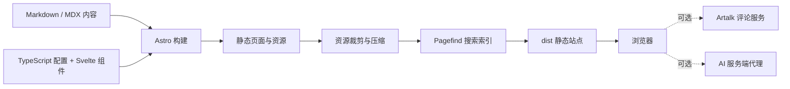

<div align="center">


# 启明的博客

**记录 AI 资讯、技术实践与持续学习。**

基于 Firefly 定制的个人博客 · Astro 静态生成 · Svelte 交互组件

[](https://astro.build/)
[](https://svelte.dev/)
[](https://www.typescriptlang.org/)
[](https://github.com/liqiming123/liqiming-blog/actions/workflows/build.yml)
[](LICENSE)
[](https://github.com/liqiming123/liqiming-blog/stargazers)

[在线演示](https://liqiming.top) · [快速开始](#快速开始) · [配置指南](#配置指南) · [问题反馈](https://github.com/liqiming123/liqiming-blog/issues)

**简体中文** | [English](README.en.md)

</div>


## 关于项目

这是 [liqiming.top](https://liqiming.top) 的博客源码，用于发布 AI 资讯、软件工程笔记和个人动态，也可以作为搭建个人技术博客的参考。文章保存在 Markdown / MDX 文件中，构建后生成静态页面，不需要数据库即可浏览文章、归档和项目页。

项目基于 [CuteLeaf / Firefly](https://github.com/CuteLeaf/Firefly) 二次开发，保留主题的配置能力，并加入本站的内容、视觉设置、Artalk 自托管前端、Live2D 对话界面和 RSS / Atom 阅读体验调整。Firefly 的上游为 [saicaca / Fuwari](https://github.com/saicaca/fuwari)。

## 演示截图

以下为本项目生产构建的真实截图，展示桌面首页和移动端布局。桌面截图见上方，点击图片可查看原图。

<details>
<summary>查看移动端演示（440 px 视口）</summary>

<p align="center">
  
</p>

</details>

## 功能特性

- **全栈管理后台**：`admin/`（Vue3）+ `server/`（Hono）提供在线写作与运营闭环——文章/说说/相册/友链/书签/公告/关于页管理、Artalk 评论管理、用户与角色、审计与异常日志；写操作自动触发构建发布（原子交换，约 40 秒上线）。详见 [docs/admin/](docs/admin/)。
- **自建访客统计（观星台）**：前台埋点 + ip2region 离线地域解析 + 指纹去重（不存明文 IP），仪表盘含趋势、热门文章与 3D 地球仪地域分布；前台侧栏"热门文章"由同一份数据构建期直读生成，零客户端 JS。
- **内容优先**：Markdown / MDX 写作，文章分类、标签、时间归档、系列文章与阅读目录。
- **全文搜索**：Pagefind 在构建阶段生成索引，浏览器端搜索文章，无需搜索服务。
- **个性化外观**：明暗主题、主题色、壁纸轮播、侧栏与文章布局配置，支持移动端响应式布局。
- **个人内容空间**：动态、项目展示、相册、书签导航、友链、关于页与留言板。
- **交互体验**：Svelte 组件、Swup 页面过渡、沉浸式阅读与 Live2D 看板娘。
- **评论与 AI 对话**：自托管 Artalk 前端；看板娘支持流式对话、短期上下文和 OpenAI 兼容格式的服务端代理。
- **内容分发**：RSS / Atom、站点地图、Open Graph 图片及搜索引擎元信息。
- **构建优化**：图片低清占位、按配置裁剪看板娘资源、字体子集化和内联脚本压缩。

> 博客主体可独立运行。评论和 AI 对话依赖另外部署的服务；本仓库包含前端与接入说明，不包含线上数据库、AI 代理程序或任何服务密钥。具体配置见[可选后端服务](#可选后端服务)。

## 技术栈

版本以 [package.json](package.json) 和 [pnpm-lock.yaml](pnpm-lock.yaml) 为准。

| 技术 | 项目中的用途 |
| --- | --- |
| Astro 7.3.2 | 文件路由、内容集合、静态页面生成、图片处理 |
| Svelte 5 | 搜索、主题设置、筛选等交互组件 |
| TypeScript 6 | 配置、内容处理与组件的类型约束 |
| Tailwind CSS 4 + Stylus | 响应式布局、主题变量与组件样式 |
| Markdown / MDX + remark / rehype | 文章写作、扩展语法、链接与内容转换 |
| Expressive Code + KaTeX | 代码块展示与数学公式 |
| Pagefind | 构建时索引与浏览器端全文搜索 |
| Swup | 页面切换与过渡效果 |
| Artalk 2.10.0 | 自托管评论前端，后端单独部署 |
| Hono + node:sqlite | 管理后台 API 服务（会话、审计、访客统计、发布管线触发） |
| Vue 3 + Naive UI + echarts | 管理后台 SPA 与数据可视化（含 echarts-gl 地球仪） |
| Live2D / Pio | 看板娘模型、动作与交互菜单 |
| Biome + pnpm + GitHub Actions | 格式化、依赖管理、类型检查与生产构建 |



## 快速开始

### 1. 准备环境

- **Node.js ≥ 22.23.0**，建议使用 Node.js 24。
- **pnpm 11.22.0**，与项目的 `packageManager` 一致。
- 使用 Git 克隆时需要安装 Git；也可以直接下载 ZIP。

```bash
node --version
npm install --global pnpm@11.22.0
pnpm --version
```

### 2. 下载项目

```bash
git clone https://github.com/liqiming123/liqiming-blog.git
cd liqiming-blog
```

不使用 Git 时，可[下载源码 ZIP](https://github.com/liqiming123/liqiming-blog/archive/refs/heads/main.zip)，解压后在含 `package.json` 的目录打开终端。

### 3. 安装并启动

```bash
pnpm install --frozen-lockfile
pnpm dev
```

打开 **http://localhost:4321**。端口被占用时，以终端输出的地址为准。首次安装需要联网下载依赖；基础页面不要求 `.env` 文件或 API Key。

### 4. 验证生产效果

```bash
pnpm check
pnpm type-check
pnpm build
pnpm preview
```

打开预览命令输出的地址，通常仍为 **http://localhost:4321**。完整搜索索引在 `pnpm build` 后生成，测试全文搜索请使用构建后的预览。

> 请使用完整的 `pnpm build`。只执行 `astro build` 会跳过后续资源处理和 Pagefind 索引生成，导致部署后的搜索无法正常工作。

## 常用命令

| 命令 | 说明 |
| --- | --- |
| `pnpm dev` | 启动开发服务器，修改内容后自动更新 |
| `pnpm check` | 检查 Astro、Svelte 和 TypeScript 诊断 |
| `pnpm type-check` | TypeScript 类型检查 |
| `pnpm build` | 完整生产构建，输出到 `dist/` |
| `pnpm preview` | 本地预览已有生产构建 |
| `pnpm new-post my-first-post` | 新建 `src/content/posts/my-first-post.md` |
| `pnpm new-dynamic "今天的开发记录"` | 新建一条带时间戳的动态 |
| `pnpm format` | 格式化 `src/` 和 `scripts/`，会修改文件 |
| `pnpm lint` | Biome 检查并应用安全修复，会修改文件 |

## 配置指南

配置集中在 `src/config/`，由 `src/config/index.ts` 统一导出。搭建自己的站点时，先替换站点地址、个人资料、文章内容和第三方服务地址。

| 想修改的内容 | 文件 |
| --- | --- |
| 标题、域名、语言、主题色、页面开关、站点图标 | [`src/config/siteConfig.ts`](src/config/siteConfig.ts) |
| 头像、昵称、个人简介和社交链接 | [`src/config/profileConfig.ts`](src/config/profileConfig.ts) |
| 导航栏与页面入口 | [`src/config/navBarConfig.ts`](src/config/navBarConfig.ts) |
| 首页标题、壁纸与轮播 | [`src/config/backgroundWallpaper.ts`](src/config/backgroundWallpaper.ts) |
| 侧栏与布局 | [`src/config/sidebarConfig.ts`](src/config/sidebarConfig.ts) |
| 评论提供商和后端地址 | [`src/config/commentConfig.ts`](src/config/commentConfig.ts) |
| Live2D 模型、菜单和 AI 聊天 | [`src/config/pioConfig.ts`](src/config/pioConfig.ts) |
| 友链、相册、书签、打赏 | `friendsConfig.ts`、`galleryConfig.ts`、`booknavConfig.ts`、`sponsorConfig.ts` |

### 写一篇文章

```bash
pnpm new-post my-first-post
```

编辑新生成的 Markdown 文件，例如：

```yaml
---
title: 我的第一篇技术笔记
published: 2026-09-18
description: 记录一次可复现的工程实践。
tags: [Astro, 开发记录]
category: 技术笔记
slug: my-first-post
draft: false
---
```

在 Frontmatter 下方写正文即可。设置 `draft: true` 可将文章标记为草稿。

### 可选后端服务

| 功能 | 本地体验 / 自行部署时如何处理 |
| --- | --- |
| Artalk 评论 | 仅浏览文章时可将 `commentConfig.type` 设为 `"none"`；启用评论时替换 `artalk.server` 为自己的服务地址，并让后端站点名与 `siteConfig.title` 一致。 |
| 管理后台 | `admin/` 与 `server/` 为本站自建，可独立于博客运行；不含任何密钥与数据文件（`server/.env`、`server/data/` 已被 gitignore），部署方式见 [docs/admin/](docs/admin/)。 |
| 看板娘 AI 聊天 | 仅展示模型时，将 `live2dWidgetConfig.chat.enable` 设为 `false`；启用对话时将 `chat.apiEndpoint` 指向自己的代理。 |
| AI 密钥 | 保存在服务端代理中。前端 `chat.apiKey` 保持空字符串，静态站配置中的密钥会进入构建产物。 |
| 其他外部内容 | 音乐、在线图源等是否可用取决于对应服务和网络环境。 |

仓库保留本站的线上配置作为示例，公共演示的评论服务与 AI 代理不承诺支持其他域名或 `localhost`。不要将它们作为自己站点的后端。

详细说明：[Artalk 前端](docs/artalk-frontend.md) · [AI 代理接入](docs/mascot-chat-proxy.md)。

## 目录结构

```text
liqiming-blog/
├── src/
│   ├── assets/         # 源图片与壁纸
│   ├── components/     # Astro / Svelte 组件
│   ├── config/         # 按功能拆分的配置
│   ├── content/        # 文章、动态、项目与独立页面
│   ├── layouts/        # 页面布局
│   ├── pages/          # 页面路由、RSS、Atom 等入口
│   ├── plugins/        # Markdown / HTML 处理插件
│   ├── styles/         # 全局与组件样式
│   ├── types/          # 类型定义
│   └── utils/          # 内容、日期、Feed 等工具
├── public/             # 图标、看板娘模型、Artalk 前端等静态文件
├── admin/              # 管理后台 SPA（Vue3 + Naive UI，构建产物部署到 /admin/）
├── server/             # 管理后台 API（Hono + node:sqlite，.env 与 data/ 不入库）
├── scripts/            # 内容生成与构建后处理
├── docs/               # 演示截图与部署说明
├── .github/            # CI 与问题模板
├── astro.config.mjs    # Astro、内容插件与构建配置
└── pnpm-lock.yaml      # 锁定的依赖版本
```

## 部署

当前演示站使用静态文件服务器托管。对于同类部署，只需完整构建后将 `dist/` 内容上传到站点根目录。

| 配置项 | 值 |
| --- | --- |
| 根目录 | 仓库根目录 |
| 安装命令 | `pnpm install --frozen-lockfile` |
| 构建命令 | `pnpm build` |
| 输出目录 | `dist` |
| Node.js | 24（或满足 `>=22.23.0` 的版本） |

部署前替换 `siteConfig.site_url`。项目默认 `base: "/"`，适合域名根路径；部署到子目录时，需要同步调整 `astro.config.mjs` 的 `base` 并验证资源路径。

GitHub Actions 对 `main` 分支执行类型检查与完整构建；GitHub Pages 工作流仅保留手动触发入口，需要自行配置 Pages 和站点路径。公开源码不会自动替换你的线上服务。

完整步骤见 [部署指南](docs/deploy.md)。

## 常见问题

**启动提示 Node 版本不满足要求？** 升级到 Node.js 24 后重新安装依赖。项目声明的最低版本是 `22.23.0`。

**为什么不能用 npm / yarn 安装依赖？** 项目通过 `preinstall` 约束使用 pnpm，请使用锁定的 pnpm 版本和 `pnpm-lock.yaml`。

**开发模式下搜索没有结果？** 先执行 `pnpm build`，再通过 `pnpm preview` 检查生成的 Pagefind 索引。

**评论或 AI 对话报跨域 / 连接错误？** 这两项依赖独立后端。按上面的可选服务说明关闭，或配置自己的服务。

## 参与贡献

欢迎通过 [Issues](https://github.com/liqiming123/liqiming-blog/issues) 反馈问题，通过 Pull Request 提交改进。请附上复现步骤、运行环境，以及与界面问题相关的截图。提交前运行 `pnpm check`、`pnpm type-check` 和 `pnpm build`。具体流程见 [CONTRIBUTING.md](CONTRIBUTING.md)。

## 致谢与许可证

- [Firefly](https://github.com/CuteLeaf/Firefly)：本项目直接使用的博客主题基础。
- [Fuwari](https://github.com/saicaca/fuwari)：Firefly 的上游主题。
- Mizuki / Pio：本项目的 Live2D 运行时和模型参考来源。
- Astro、Svelte、Pagefind、Artalk 及其他依赖的维护者。

代码沿用 [MIT License](LICENSE)，保留上游版权与许可声明。文章、引用内容、壁纸、字体、音乐及 Live2D 模型等素材，按其各自来源和许可使用；代码的 MIT 许可不替代这些素材的授权。
